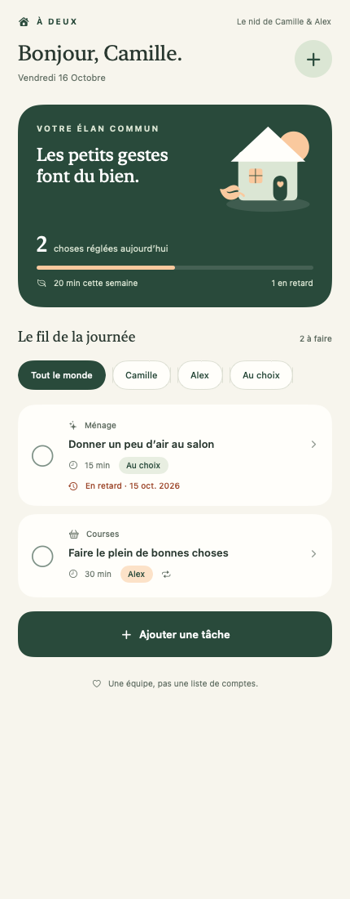
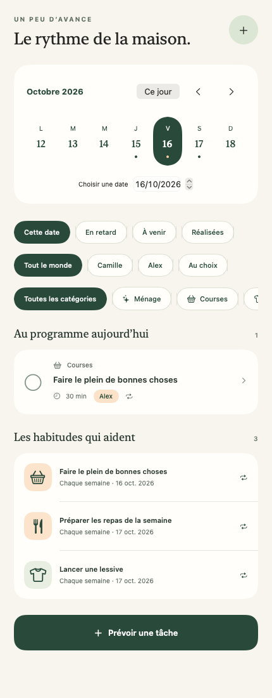
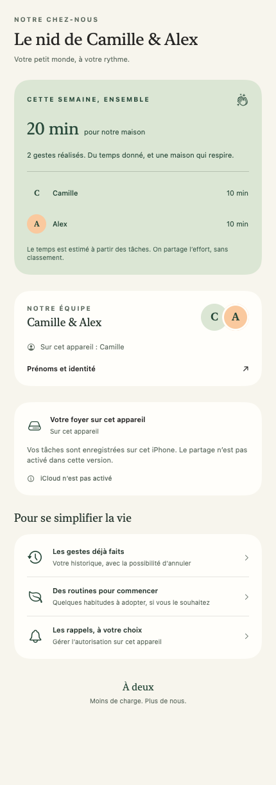

# À deux

**Une maison. Deux équipiers.** Une application iPhone en SwiftUI pour se partager les petites choses du quotidien — sans classement, sans compétition, sans serveur à gérer.

<p align="center"></p>

## Ce que contient cette première version

- **Aujourd’hui** : tâches du jour, retards, filtres par personne et progression commune.
- **Planning** : navigation par semaine/date, tâches à venir, catégories, routines et réalisations.
- **Maison** : vos prénoms, identité propre à chaque iPhone, bilan des efforts, historique et invitation iCloud.
- Ajout/modification/suppression, notes, attribution et durée estimée.
- Routines quotidiennes, hebdomadaires ou mensuelles ; annulation d’une validation accidentelle.
- Sauvegarde locale hors connexion et intégration du partage CloudKit entre deux comptes Apple.
- Rappels locaux facultatifs, demandés uniquement lorsque vous les activez.
- Interface française, VoiceOver, texte agrandi et mouvement réduit pris en compte dans les composants.

Le foyer commence vide. Des routines de départ sont disponibles sur demande explicite dans Maison. Aucun compte applicatif, SDK publicitaire ou service tiers n’est intégré.

## Aperçu

<p align="center">



</p>

Écrans SwiftUI réels rendus sur macOS avec un foyer de démonstration, sans la barre d’onglets iOS. Ces images ne constituent pas un test du simulateur iPhone. `make preview` les régénère depuis une session graphique macOS ; `./scripts/render-preview.sh --live` ouvre une démonstration interactive locale, et `--large-text` produit les aperçus avec la branche de mise en page accessible.

## Lancer l’app

Prérequis : **Xcode 16+**, iOS 17+, Mac compatible avec Xcode. Pour les modules partagés et tests : Swift 6+, macOS 14+. Le langage applicatif reste en mode Swift 5.

```sh
git clone https://github.com/pivox/home.git
cd home
open ADeux.xcodeproj
```

Choisir le schéma **ADeux**, sélectionner un simulateur iPhone et lancer avec **⌘R**. Pour un téléphone physique, copier `Config/Signing.local.xcconfig.example` en `Config/Signing.local.xcconfig` et renseigner votre équipe et un identifiant d’application disponible. Ce fichier personnel est ignoré par Git.

**Le schéma ADeux est local.** Pour l’utiliser à deux sur vos iPhone, configurer le conteneur Apple puis lancer le schéma **ADeux-iCloud**. Le guide [configuration Apple et test à deux comptes](docs/apple-setup.md) décrit chaque étape. Les tâches locales restent dans le même magasin privé lors du passage au schéma iCloud.

## Développer

Aucune dépendance de paquet tierce et aucun générateur externe requis. `ADeux.xcodeproj` est livré et reproductible par le script Python.

| Commande | Résultat |
| --- | --- |
| `make test` | Tests Swift Testing : domaine, persistance et rappels |
| `make build` | Compilation de l’interface partagée sur macOS |
| `make validate` | Cohérence des fichiers, skills, projet, ressources et syntaxe iOS/scripts |
| `make ios-build` | Compilation simulateur iPhone sans signature, avec Xcode complet |
| `make project` | Régénération déterministe du projet Xcode |
| `make preview` | Aperçu natif de développement ; voir les capacités du script |

Les scripts gardent les caches et les ajustements des Command Line Tools dans un répertoire temporaire. Ils ne modifient pas l’installation Swift du Mac. `ADEUX_CACHE_DIR` et `ADEUX_BUILD_DIR` permettent de choisir les emplacements de travail.

## Travailler avec un agent

- [AGENTS.md](AGENTS.md) : architecture, invariants et preuves attendues.
- [CLAUDE.md](CLAUDE.md) : entrée Claude, qui importe les règles communes.
- [agent.md](agent.md) : pointeur vers les règles canoniques.
- [.agents/skills](.agents/skills) : développement SwiftUI, partage CloudKit et validation du projet. Les mêmes skills sont accessibles à Claude via `.claude/skills`.
- [Architecture](docs/architecture.md), [contribution](CONTRIBUTING.md), [suite du projet](docs/roadmap.md).

La CI GitHub vérifie le dépôt, les tests Swift, la compilation des vues partagées et celle de l’application pour iPhone Simulator. Elle ne dispose pas de comptes iCloud ni de signature de distribution.

## État de validation

Le détail des commandes réellement exécutées et des limites est conservé dans [docs/verification.md](docs/verification.md). La compilation macOS et les tests locaux ne remplacent pas un lancement iPhone et un essai iCloud sur deux comptes. La configuration/signature Apple est propre à votre équipe et ne figure pas dans le dépôt.

Les conflits simultanés sur une même tâche, le départ d’un partage et les notifications sur appareils réels font partie des essais à effectuer avant une diffusion plus large ; voir les limites concrètes dans [architecture.md](docs/architecture.md).
